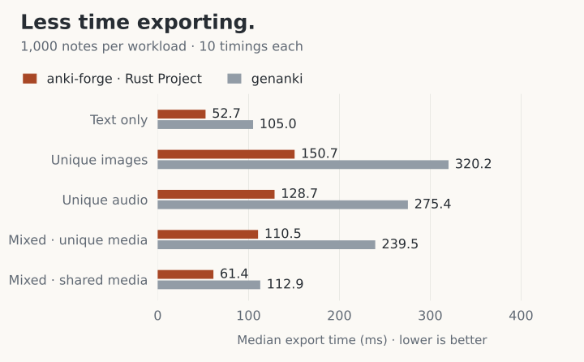

<p align="center">
  <picture>
    <source media="(prefers-color-scheme: dark)" srcset="docs/assets/brand/ankiforge-dark.svg">
    
  </picture>
</p>

<h1 align="center">anki-forge</h1>

<p align="center">
  <a href="https://github.com/morehardy/anki-forge/actions/workflows/contract-ci.yml"></a>
  <a href="https://crates.io/crates/ankiforge"></a>
  <a href="https://www.npmjs.com/package/ankiforge"></a>
  <a href="https://pypi.org/project/ankiforge/"></a>
  <a href="https://ankiforge.dev/docs/"></a>
  <a href="LICENSE"></a>
</p>

[English](README.md) · 简体中文

[官网](https://ankiforge.dev/) · [使用文档](https://ankiforge.dev/docs/) ·
[GitHub](https://github.com/morehardy/anki-forge) · [问题反馈](https://github.com/morehardy/anki-forge/issues)

**把代码和数据，变成可持续维护的 Anki 牌组。**

Anki Forge 是开源的 Anki APKG 生成库，以 Rust 为核心，提供 Rust、Python、Node.js 接口。
使用公开的 `ankiforge` 包制作基础问答、填空、图片遮挡与自定义卡片，按 MIT 许可证分发。
一起打包模板和媒体，并在分发新版前检查身份与内容变化。

[性能对比](#可核验的性能表现) · [快速开始](#快速开始) ·
[卡片示例](#丰富的卡片形式) · [更新流程](#持续改进已发布的牌组) ·
[选择开发语言](#选择你的开发语言)

## 为什么选择 anki-forge？

- **让卡片适合你的内容。** 支持基础问答（Basic）、填空（Cloze）、图片遮挡、自定义 HTML/CSS 模板，
  以及图片、音频和视频。[查看卡片示例 ↓](#丰富的卡片形式)
- **缩短导出等待。** Rust 核心负责牌组生成和媒体打包，常规导出无需安装 Anki。
  [查看五种场景的实测结果 ↓](#可核验的性能表现)
- **发布之后，持续完善。** 与上一版牌组对比，检查笔记身份与更新风险，
  并查看结构化构建报告。[了解更新流程 ↓](#持续改进已发布的牌组)

## 可核验的性能表现

**1,000 条文本笔记 52.7 ms 完成导出**，genanki 为 105.0 ms，**耗时减少 49.8%**。
在五种 1,000 条笔记场景中，Rust 导出耗时均少 **45.7–53.9%**。数据对比 Rust
`Project` API（使用 `Media::files`）和 genanki 0.13.1；Node 与 Python 绑定未参与测试。

<picture>
  <source media="(max-width: 600px) and (prefers-color-scheme: dark)" srcset="docs/assets/readme/export-times-dark-mobile.svg">
  <source media="(max-width: 600px)" srcset="docs/assets/readme/export-times-light-mobile.svg">
  <source media="(prefers-color-scheme: dark)" srcset="docs/assets/readme/export-times-dark.svg">
  
</picture>

本次基准测试通过了 840 次输出内容检查和 40 次 Anki 导入、内容与代表性渲染检查。
部分媒体场景占用更多内存：独立图片场景峰值 RSS 为 92.45 MiB，genanki 为 35.59 MiB。

<details>
<summary>测试方法与完整结果</summary>

五种场景覆盖 100、200、500 和 1,000 条笔记，每格包含 10 次计时和 5 次 RSS 测量。
计时从进程启动到退出，包含媒体导入、构建、检查和写入；后台负载、页缓存及不同的默认 APKG
格式未隔离。完整数据和复现步骤见下方报告。

| 1,000 条笔记 | Rust 峰值 RSS（MiB） | genanki 峰值 RSS（MiB） | 速度比 |
| --- | ---: | ---: | ---: |
| 文本 | 21.91 | 32.25 | 1.99× |
| 独立图片 | 92.45 | 35.59 | 2.12× |
| 独立音频 | 62.66 | 35.97 | 2.14× |
| 混合独立媒体 | 65.19 | 35.03 | 2.17× |
| 混合共享媒体 | 29.36 | 32.66 | 1.84× |

[完整报告](https://github.com/morehardy/anki-forge/blob/bef4aeb653fc875f216614e73d8a617be039b9cf/benchmarks/results/20261008-latest-commit-genanki/report.md) · [原始 CSV](https://github.com/morehardy/anki-forge/blob/bef4aeb653fc875f216614e73d8a617be039b9cf/benchmarks/results/20261008-latest-commit-genanki/comparison.csv) · [复现说明](https://github.com/morehardy/anki-forge/blob/bef4aeb653fc875f216614e73d8a617be039b9cf/benchmarks/results/20261008-latest-commit-genanki/README.md)

</details>

## 选择你的开发语言

运行时要求以及客户端和平台限制见[兼容性](docs/compatibility.md)。

| 语言 | 运行时 | 公开包 | 安装命令 | 指南 |
| --- | --- | --- | --- | --- |
| Rust | Rust 1.92+ | [ankiforge 0.3.1](https://crates.io/crates/ankiforge) | `cargo add ankiforge@0.3.1` | [Rust](docs/installation.md) |
| Node / TypeScript | Node 22.13+ | [ankiforge 0.3.1](https://www.npmjs.com/package/ankiforge) | `npm install --include=optional ankiforge@0.3.1` | [Node](docs/node/quick-start.md) |
| Python | CPython 3.11+ | [ankiforge 0.3.1](https://pypi.org/project/ankiforge/) | `python -m pip install ankiforge==0.3.1` | [Python](docs/python/quick-start.md) |

常见任务：[CSV 转 Anki（Python）](https://ankiforge.dev/zh-cn/docs/csv-to-anki/) ·
[JSON 转 Anki](https://ankiforge.dev/zh-cn/docs/json-to-anki/) ·
[AI 辅助生成 Anki 卡片](https://ankiforge.dev/zh-cn/docs/ai-anki-cards/) ·
[Anki Forge 与 genanki 比较](https://ankiforge.dev/zh-cn/docs/anki-forge-vs-genanki/)

<!-- ai-quickstart:start -->
## 与 AI 编码助手一起使用

将下方提示复制到 ChatGPT、Cursor、Claude Code 或其他编码助手。
这是 Rust 模板；选择 Node / TypeScript 或 Python 时，请使用官网生成对应语言的提示。
替换需求占位符后粘贴给 AI。

```text
请帮助我在 Rust 项目中使用 Anki Forge 0.3.1。
运行时要求：Rust 1.92+

只使用该版本公开文档中的 `ankiforge` 包和公开 API。不要使用 git/path
依赖、internal tools、仅源码可用的 API、未发布方法或猜测出来的方法。

我的目标：
<描述你的需求>

请按以下要求完成：
1. 先检查现有项目，再决定需要新增或修改哪些文件。
2. 给出准确的安装命令：cargo add ankiforge@0.3.1
3. 生成最小但完整、可以直接运行的程序，列出新增或修改的文件。
4. 输出持久化的 `.apkg`，并使用稳定的 namespace 和 note key。
5. 给出运行命令、预期输出和验证步骤。
6. 如果涉及媒体、自定义模板、图片遮挡或牌组更新，请遵循文档中的流程，
   不要自行猜测 API。更新时保留上一份原始分发 APKG 作为基线，不使用 Anki 重新导出的包。
7. 只有在语言、输入格式、输出路径或身份规则无法判断时才提问。

快速开始文档：https://ankiforge.dev/zh-cn/docs/quickstart/
```

[打开交互式提示生成器](https://ankiforge.dev/zh-cn/#ai-quickstart)

支持 Skill 的编码助手可按需加载语言安装、公开 API 规则、任务流程和验证指南：

[查看 Anki Forge Skill](skills/anki-forge/SKILL.md) · [Skill 加载说明](docs/ai-assistants.md)
<!-- ai-quickstart:end -->

## 快速开始

三种语言都生成持久文件 `spanish.apkg`，包含 Spanish 牌组中的 **hola → hello**。

<details>
<summary>Rust</summary>

```sh
cargo new anki-deck
cd anki-deck
cargo add ankiforge@0.3.1
```

保存为 `src/main.rs`:

<!-- source: anki_forge/examples/target_api_basic.rs -->
```rust
use ankiforge::{BuildOptions, Note, Project};

fn main() -> Result<(), Box<dyn std::error::Error>> {
    let mut project = Project::new("spanish")?.default_deck("Spanish");
    project.add("es:hola", Note::basic("hola", "hello"))?;
    let output = project.build(BuildOptions::to("spanish.apkg"))?;
    println!("{}", output.artifact().path().display());
    Ok(())
}
```
<!-- /source -->

```sh
cargo run
```

</details>

<details>
<summary>Node / TypeScript</summary>

```sh
mkdir anki-deck
cd anki-deck
npm install --include=optional ankiforge@0.3.1
```

保存为 `main.mjs`:

<!-- source: bindings/node/examples/quickstart.mjs -->
```js
import { Project, Note, BuildOptions } from 'ankiforge';

const project = new Project('spanish').defaultDeck('Spanish');
project.add('es:hola', Note.basic('hola', 'hello'));
const output = await project.build(BuildOptions.to('spanish.apkg'));
console.log(output.artifact.path);
await output.artifact.close();
```
<!-- /source -->

```sh
node main.mjs
```

</details>

<details>
<summary>Python</summary>

```sh
python -m venv .venv
. .venv/bin/activate
python -m pip install ankiforge==0.3.1
```

保存为 `main.py`:

<!-- source: bindings/python/examples/quickstart.py -->
```python
from ankiforge import Project, Note, BuildOptions

project = Project('spanish', default_deck='Spanish')
project.add('es:hola', Note.basic('hola', 'hello'))
output = project.build(BuildOptions.to('spanish.apkg'))
print(output.artifact.path)
```
<!-- /source -->

```sh
python main.py
```

</details>

将文件导入 Anki 开始学习。常规导出无需安装 Anki；环境要求见[兼容性](docs/compatibility.md)。Windows 虚拟环境使用 `.venv\Scripts\Activate.ps1` 激活。

## 丰富的卡片形式

将内容、模板和媒体放在一起管理。同一份牌组可以组合使用：

- **基础问答（Basic）：** 正面显示 **hola**，翻面查看答案 **hello**。
- **填空（Cloze）：** 题面显示“A sound's pitch depends on its […]”，揭示被隐藏的 **frequency**。
- **自定义卡片 + 媒体：** 展示波形图并播放一秒钟的音频，再揭示答案 **A4 · 440 Hz**。
  卡片布局和样式由你通过 HTML/CSS 定义。

运行自包含的[卡片展示示例](anki_forge/examples/readme_showcase.rs)，即可生成这三张卡片：

```sh
cargo run -q -p ankiforge --example readme_showcase
```

示例会生成 `readme-showcase.apkg`，包含三张卡片，以及现场生成的波形图和一秒钟的音频，
无需下载媒体文件。也可以直接[下载已生成的示例牌组](docs/assets/readme/showcase.apkg?raw=true)，
或查看[示例验证与复现说明](docs/assets/readme/README.md)。

| 想制作更丰富的卡片 | 从这里开始 |
| --- | --- |
| 自定义字段、布局和卡片生成规则 | [自定义笔记类型](anki_forge/examples/target_api_custom_notetype.rs) |
| 图片、声音和模板媒体 | [媒体示例](anki_forge/examples/target_api_media.rs) · [故障排查](docs/troubleshooting.md) |
| 可复用的模板、CSS 和资源 | [模板包](docs/template-bundles.md) |
| 图片遮挡（Image Occlusion） | [制作图片问题](docs/image-occlusion.md) |

## 持续改进已发布的牌组

假设你已经发布了一份西班牙语牌组，现在想完善一个释义：

| 版本 | 稳定笔记 ID | 正面 | 背面 |
| --- | --- | --- | --- |
| `spanish-v1.apkg` | `es:hola` | hola | hello |
| `spanish-v2.apkg` | `es:hola` | hola | hello; hi |

保留上一次分发的 APKG。修改 `Project` 中的笔记后，将它作为下一次构建的对比基线：

```rust
let options = BuildOptions::to("spanish-v2.apkg")
    .update_from("spanish-v1.apkg");
let output = project.build(options)?;
println!("{:?}", output.report().comparison());
```

[可直接运行的更新示例](anki_forge/examples/readme_update.rs) 会生成两个版本，并打印对比报告：

```sh
cargo run -q -p ankiforge --example readme_update
```

namespace 和 note key 标识笔记。每个生成的 APKG 都携带完整身份和修订证据；
保留原始分发包，并用 `update_from` 生成下一版本。Anki 重新导出的包不作为基线。
字段是否更新仍取决于客户端导入设置和本地修改时间。风险策略、实际导入验证
与客户端限制见[完整更新流程](docs/updates.md)。

## 参与贡献

环境要求、检查步骤、架构决策与发布流程见[开发指南](docs/development.md)。
欢迎通过 [GitHub Issues](https://github.com/morehardy/anki-forge/issues) 报告问题或提出功能需求。
安全问题请按照[安全策略](SECURITY.md)报告。

## 许可证

项目自有代码使用 [MIT 许可证](LICENSE)。镜像收录的源码和其他第三方源码保留各自的许可证。
